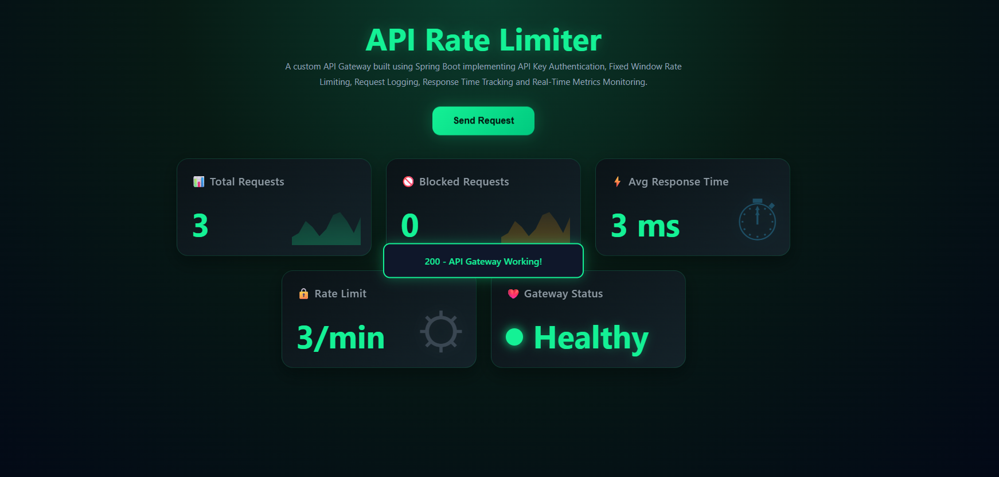
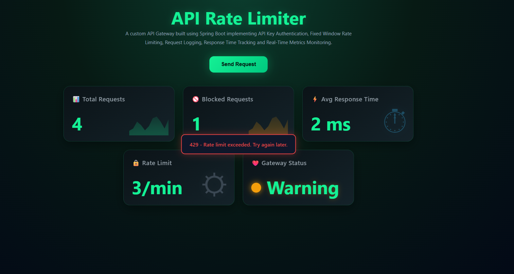

# 🚀 Spring Boot API Gateway with Rate Limiting & Monitoring

A production-oriented API Gateway built using Spring Boot that provides API Key Authentication, Fixed Window Rate Limiting, Request Logging, Response Time Monitoring, Metrics Collection, and a Real-Time Monitoring Dashboard.

## 📖 Overview

This project demonstrates how an API Gateway acts as the first line of defense in backend systems by handling authentication, request filtering, traffic throttling, monitoring, and metrics collection.

The gateway validates incoming requests, enforces rate limits, records request metrics, tracks response times, and provides a dashboard for real-time system observability.

---

## 📸 Dashboard Preview

### ✅ Healthy State



### ⚠️ Warning State (Rate Limit Exceeded)



---

## 📌 Features

- ✅ API Key Authentication
- ✅ Fixed Window Rate Limiting
- ✅ Request Logging
- ✅ Response Time Tracking
- ✅ Real-Time Metrics Collection
- ✅ Gateway Health Monitoring
- ✅ Interactive Monitoring Dashboard

---

## 🛠️ Tech Stack

### Backend

- Java 21
- Spring Boot
- Spring MVC
- Lombok

### Frontend

- HTML
- CSS
- JavaScript

### Core Concepts

- API Gateway Pattern
- Spring Filters
- Fixed Window Rate Limiting
- ConcurrentHashMap
- AtomicLong
- Metrics Monitoring
- System Observability

---

## 🏗️ Architecture

```text
Client Request
      |
      ▼
 ┌─────────────┐
 │ ApiKeyFilter│
 └─────────────┘
      |
      ▼
 ┌─────────────┐
 │LoggingFilter│
 └─────────────┘
      |
      ▼
 ┌────────────────┐
 │RateLimitFilter │
 └────────────────┘
      |
      ▼
 ┌─────────────┐
 │ Controller  │
 └─────────────┘
      |
      ▼
    Response
```

---

## 🔐 API Key Authentication

All protected APIs require a valid API Key.

### Example

```http
GET /api/demo

X-API-KEY: demo-key
```

Invalid or missing API keys return:

```http
401 Unauthorized
```

---

## 🚦 Fixed Window Rate Limiting

### Current Configuration

```java
LIMIT = 3 requests
WINDOW_SIZE = 60 seconds
```

### Example

```text
Request 1 ✅
Request 2 ✅
Request 3 ✅
Request 4 ❌ 429 Too Many Requests
```

When the limit is exceeded, the gateway blocks additional requests until the time window resets.

---

## 📊 Monitoring Dashboard

The dashboard provides real-time visibility into:

- Total Requests
- Blocked Requests
- Average Response Time
- Configured Rate Limit
- Gateway Health Status

This helps monitor traffic patterns and identify potential abuse or performance bottlenecks.

---

## ❤️ Gateway Status

### Healthy

```text
Blocked Requests = 0
```

### Warning

```text
Blocked Requests > 0
```

A warning status indicates that requests are being throttled while the gateway remains operational.

---

## ⚡ Response Time Tracking

The gateway records:

```text
Request Start Time
Request End Time
Response Time
```

and continuously calculates:

```text
Average Response Time
```

to monitor API performance and system responsiveness.

---

## 📂 Project Structure

```text
src
│
├── controller
│   ├── DashboardController.java
│   ├── DemoController.java
│   └── MetricsController.java
│
├── filter
│   ├── ApiKeyFilter.java
│   ├── LoggingFilter.java
│   └── RateLimitFilter.java
│
├── service
│   ├── ApiKeyService.java
│   ├── MetricsService.java
│   └── RateLimitService.java
│
├── model
│   ├── DashboardResponse.java
│   └── MetricsResponse.java
│
└── resources
    ├── static
    │   ├── index.html
    │   ├── style.css
    │   └── script.js
    │
    └── application.properties
```

---

## ▶️ Running the Application

### Clone the Repository

```bash
git clone https://github.com/jeevitha9801/api-gateway-service.git
```

### Navigate to the Project

```bash
cd api-gateway-service
```

### Run the Application

```bash
mvn spring-boot:run
```

### Access the Dashboard

```text
http://localhost:8080
```

---

## 🎯 Key Learnings

Through this project, I gained hands-on experience with:

- Spring Boot Filters
- API Authentication
- Fixed Window Rate Limiting
- Request Monitoring
- Response Time Tracking
- Thread-Safe Metrics Collection
- Dashboard Development
- Real-Time System Monitoring
- Backend Observability

---

## 🚀 Future Enhancements

- Redis-Based Distributed Rate Limiting
- JWT Authentication
- Dynamic API Key Management
- Docker Support
- Prometheus Integration
- Grafana Dashboards
- Sliding Window Rate Limiter
- Token Bucket Algorithm

---

## 👨‍💻 Author

**Jeevitha Rahiman**

*Passionate about Backend Development, System Design, and building scalable Java applications.*

---

## 📄 License

This project is licensed under the MIT License.

---
